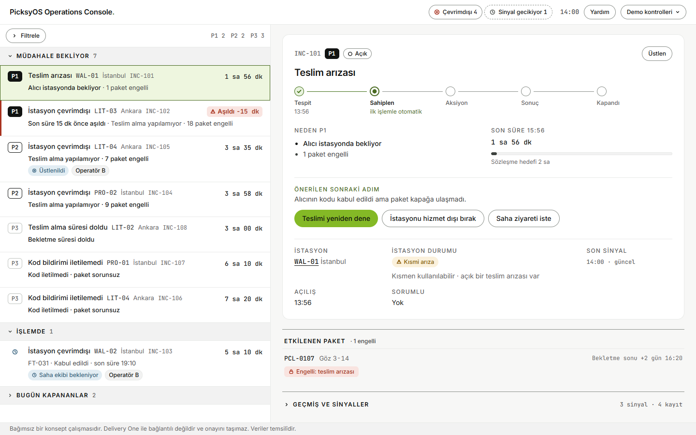
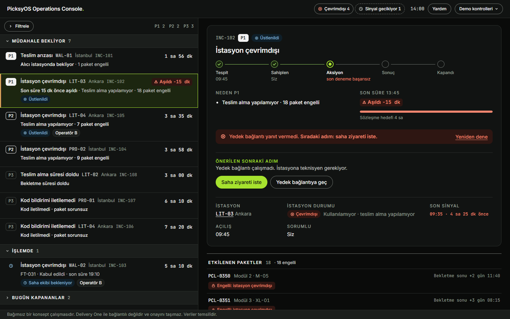
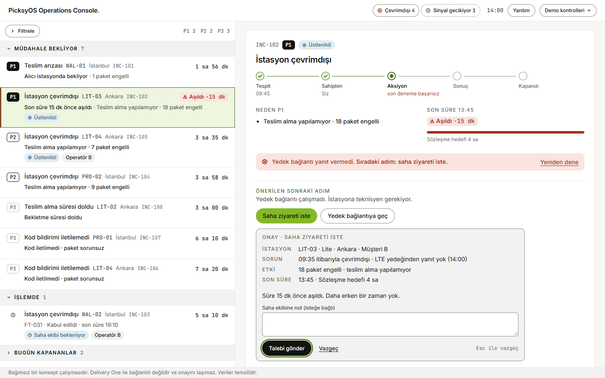
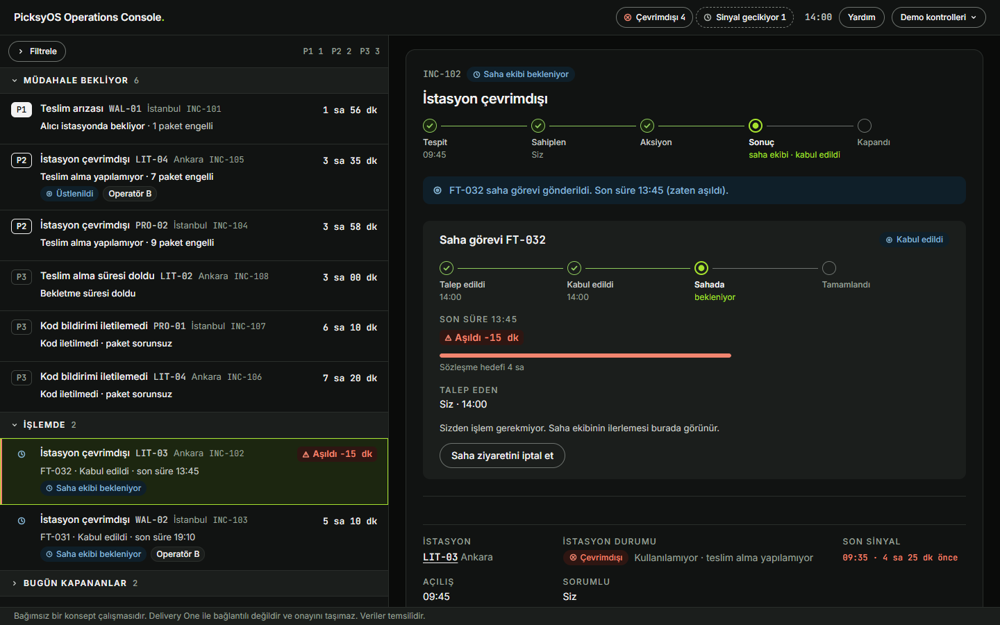
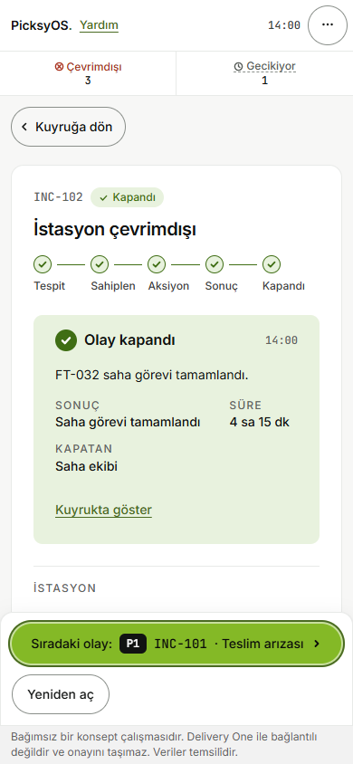

# PicksyOS Operations Console

> **Independent concept.** Not affiliated with or endorsed by Delivery One. All stations, customers, parcels, counts and durations are invented ("illustrative"). Only facts tagged S1–S9 in [`evidence.md`](evidence.md) come from Delivery One's public website.

A concept for the internal tool a remote operations operator would use to keep parcel stations (Picksy Lite, Pro, Wall) working. One queue, ranked by a written rule, shows which station issues block parcels right now, how close each one is to its contract deadline, and which fix to try next. The operator goes from alert to remote fix or field dispatch without leaving the screen.



## Try it

Requires Node 18+.

```bash
cd picksyos-console
npm install
npm run dev          # http://localhost:5173
```

- The demo clock starts at **14:00** and runs in real time. Things happen on their own: INC-104 recovers at 14:01:30, and INC-101 drops from P1 to P2 at about 14:06 if nobody acts.
- **Demo kontrolleri** (top right) holds the simulated events: the Operator/Supervisor role, theme, Reset, advancing a field task, a stress test, and a failed submit.
- `?scene=<name>` freezes a scripted state, e.g. `?scene=inc102-failed&theme=dark`. The list is in `applyScene` in [`engine.ts`](picksyos-console/src/domain/engine.ts).
- The UI is in Turkish; the docs are in English.

## Three things to try

1. **Clear the top incident (3 clicks).** Open INC-101 → "Teslimi yeniden dene" → "Onayla". The done card offers the next incident.
2. **A fix fails, then escalate.** INC-102 → "Yedek bağlantıya geç" fails → "Saha ziyareti iste" → "Talebi gönder". The field task is accepted after 10 s (simulated). Advance it from Demo kontrolleri until the station is back online.
3. **Permission.** INC-108 as Operator: "İadeye ayır" is locked and the doable step is recommended. Switch to Supervisor in Demo kontrolleri.

| Failure points to the next step | Field visit request | Field task in progress | Done, next incident |
|---|---|---|---|
|  |  |  |  |

## What is in this repository

| Path | Contents |
|---|---|
| [`picksyos-console/`](picksyos-console/) | The React 18 + TypeScript (strict) + Vite app, with its own [README](picksyos-console/README.md) |
| [`evidence.md`](evidence.md) | Public sources, analogs, hypotheses H1–H10, open questions, brand reading, design decisions D1–D17 |
| [`product-brief.md`](product-brief.md) | Problem, user, scope, flows, screen specs, edge states |
| [`operational-model.md`](operational-model.md) | Entities, freshness, state machines, actions catalogue, priority model, dataset |
| [`docs/design-system.md`](docs/design-system.md) | The canonical design system (tokens, components, copy rules) |
| [`DESIGN.md`](DESIGN.md), [`PRODUCT.md`](PRODUCT.md) | Machine-readable design and product context for design tooling |
| [`docs/design-passes-changelog.md`](docs/design-passes-changelog.md) | Every doc change made during the design passes, old → new |
| [`docs/case-study-context.md`](docs/case-study-context.md) | Full context of decisions and process, for writing the case study |
| [`HANDOFF.md`](HANDOFF.md) | Step-by-step handoff for engineers taking this toward production |
| [`design-handoff/`](design-handoff/) | The original design-tool export (file names do not match contents; see its README) |

Suggested reading order: this file → `product-brief.md` (flows) → `operational-model.md` (rules) → `docs/design-system.md`.

## Quality checks

With the dev server running, from `picksyos-console/`:

```bash
npm run typecheck
npm run build
npm run check:live   # 57 live behaviours in headless Chrome, real timers
npm run check:a11y   # 16 keyboard, focus, 200 % zoom and touch-target checks
```

Set `CHROME=` if Chrome is not at the default Windows path, and `URL=` if the dev server uses another port.

## Status

- **Built:** queue, incident panel, station and parcel pages, step bar, done card, trackable field tasks, both themes, phone layout, and keyboard support. WCAG 2.2 AA is the design target; it is verified by the a11y checks, not by an external audit.
- **Not built yet:** a first-visit "about this project" dialog and a hands-on guided tour.
- **No usability testing has been done.** The success criteria in `product-brief.md` are design criteria.
- Front end only: no back end, authentication or real integrations.

## Legal

- Delivery One, PicksyOS and the Picksy product names belong to their owners. They are used only to describe the subject of the concept. No Delivery One logo or wordmark is used.
- No licence is granted: all rights reserved by the author unless a licence file is added.
