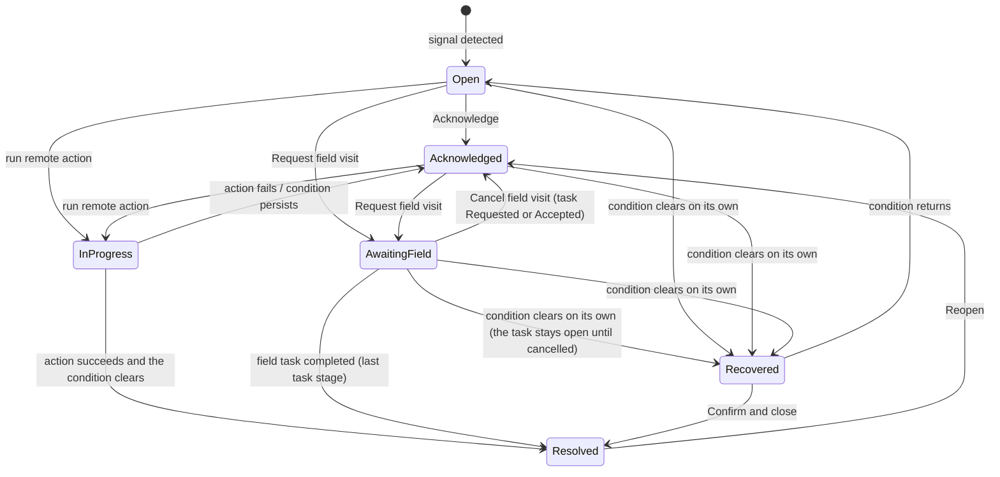

# Operational model

Concept only. Every rule here is a DESIGN DECISION, and every number is illustrative unless it is tagged FACT. Hypothesis IDs refer to `docs/evidence.md`.

## 1. Entities

| Entity | Key fields | Relationships |
|---|---|---|
| **Station** | id, name, model (Lite / Pro / Wall), customer, city, `lastSeenAt`, `hasLteBackup`, `outOfService`, `responseTarget` (from the customer contract, illustrative) | has many Parcels and Incidents |
| **Parcel** | id, stationId, compartment, recipient (masked), `arrivedAt`, `holdUntil` (illustrative, H5), `pickedUp`, `markedForReturn`, notifications[] (channel, time, delivered yes/no) | belongs to one Station. Affected by 0 to n Incidents. |
| **Incident** | id, type, stationId, `parcelIds` (only for parcel-level types), status, `openedAt`, `deadlineAt`, `deadlineSource` (contract or internal), `ackBy`, signals[], `pendingAction`, `serviceTaskId` | belongs to one Station. Has 0 or 1 Service task. Has many Events. |
| **Service task** | id, incidentId, stationId, stage (Requested, Accepted, On site, Completed, Cancelled; Proposed, D17), `requestedAt`, `acceptedAt`, `onSiteAt`, `completedAt`, `dueAt` (= incident `deadlineAt`), `requestedBy`, note (optional, sent with the request) | belongs to one Incident. One open task per incident; two incidents on one station have one task each. |
| **Event** | id, time, incidentId?, stationId?, parcelId?, kind (signal / action / state change), actor (system / operator / field), text, outcome | feeds the incident timeline, station history and parcel history |

DESIGN DECISION: counts are never stored. Every number in the UI is computed from the Parcel, Incident and Station records.

## 2. Data freshness

Each station reports a heartbeat. The reporting interval is 60 s (illustrative, H6).

| Since last heartbeat | Station state | Shown as | Incident |
|---|---|---|---|
| 3 min or less | Fresh | normal values | none |
| More than 3 min, up to 10 min | **Signal delayed** | values greyed out, "as of hh:mm", availability "Unknown" | none. The station is counted in the header as "signal delayed". |
| More than 10 min | **Offline** | availability "None" | *Station offline* is created automatically |

When the heartbeat comes back, the station returns to Fresh. An open offline incident moves to **Recovered**. DESIGN DECISION: data that may be stale is never shown as healthy (D5).

## 3. State models

### Station

The displayed state follows this precedence: Out of service, then Offline, then Signal delayed, then Degraded, then Online.

| State | Meaning, and how it is entered | Pickups | Operator action needed | Allowed actions | Exits |
|---|---|---|---|---|---|
| Online | Heartbeat is fresh and there is no fault | All | No | Set out of service (operator, confirm) | Signal delayed, Degraded, Out of service |
| Degraded | Fresh, with an open retrieval failure | Partial | Through the incident | Set out of service (operator, confirm) | Online when the incident is resolved; Signal delayed; Out of service |
| Signal delayed | No heartbeat for 3 to 10 min | Unknown | Watch | none | Online, or Offline |
| Offline | No heartbeat for more than 10 min | None. All parcels are blocked. | Through the incident | through the incident | Online when the heartbeat returns |
| Out of service | Set by an operator | None. Parcels are blocked and drop-offs stop. | Yes, until it is returned to service | Return to service (operator, confirm) | Online |

### Parcel

A parcel has one base status plus derived flags. When a parcel is affected by two incidents, both flags show.

| Base status | Meaning | Terminal |
|---|---|---|
| Ready for pickup | In the station. A code was issued. | no |
| Hold expired | `holdUntil` has passed (illustrative, H5) | no |
| Picked up | Collected by the recipient | yes |
| Marked for return | Will be collected by the carrier | yes |

| Flag (derived) | Set when | Cleared when |
|---|---|---|
| Blocked: station offline / out of service | The station is Offline or Out of service | The station is back Online |
| Blocked: retrieval fault | It is the parcel of an open retrieval-failure incident | That incident is resolved |
| Code not delivered | The last notification failed | A notification is delivered |

The displayed label follows this precedence: Blocked, then Code not delivered, then Hold expired, then Ready.

### Incident



| State | Operator sees | Action needed | Queue section |
|---|---|---|---|
| Open | priority, reason, recommended action | yes | Needs attention (ranked) |
| Acknowledged | the same, plus the owner and any last failed attempt | yes | Needs attention (ranked) |
| Action in progress | a spinner and the action name. Other actions are disabled. | no | In hand |
| Awaiting field service | the service task, its stage and its due time, counting down | no, only monitoring (cancel while Requested or Accepted) | In hand |
| Recovered | "Condition cleared at hh:mm" | confirm | Recovered: confirm to close |
| Resolved | the outcome and who closed it | no | Resolved today (collapsed) |

Note: Recovered → Open is part of the model, but no seeded scenario triggers it, so the demo does not show it.

**Checks**

- No state is a dead end. Resolved can be reopened.
- Action in progress always exits, on either success or failure.
- A field visit can be cancelled.
- Recovered can be closed, or it can reopen.
- A field visit cannot be requested while an action is running.

## 4. Actions catalog

**Rules for every action:**

- Every action writes an Event.
- If the action can't be submitted, the state does not change, and the operator sees an inline error ("Could not send. Nothing changed.") with a Retry button.
- If the action runs and fails, the result names what failed and points to the new recommendation ("Backup did not respond. Next: request a field visit."). The new recommendation is the only primary button; Retry is a quiet text link.
- The time an action spends in progress is simulated as 3 to 5 s.
- Which actions fail is fixed in the seed data, so the demo plays out the same way every time.

### Common to all types

| Action | Role | Confirm | Precondition | Success | Failure |
|---|---|---|---|---|---|
| Acknowledge | Operator | no | Open | Acknowledged. The owner is set to you. | stays Open, with an error shown |
| Take over | Operator | no (the ownership notice is the confirmation) | Acknowledged, In hand or Recovered, and owned by someone else | The owner is set to you, and the previous owner is named in the log | the owner does not change, with an error shown |
| Request field visit | Operator | yes: the confirm is the request itself (station, problem, impact, due, optional note to the field team), sent with "Talebi gönder" (Send request) | Open or Acknowledged, and no action running | Service task created in stage Requested. The incident moves to Awaiting field service. | stays as it was, with "Gönderilemedi. Hiçbir şey değişmedi." (Could not send. Nothing changed.) and Retry; no task is created |
| Cancel field visit | Operator | yes, with a required reason | Awaiting field service or Recovered, and the task is Requested or Accepted (not once the technician is On site) | Task cancelled, reason logged. An Awaiting field service incident moves to Acknowledged; a Recovered one stays Recovered. | stays as it was |
| Confirm and close | Operator | no | Recovered | Resolved | stays Recovered |
| Reopen | Operator | no | Resolved | Acknowledged | stays Resolved |
| *Field task stages* | Field service (simulated, D17) | n/a | an open task | Requested → Accepted happens on its own 10 s after the request (illustrative). Accepted → On site and On site → Completed are advanced by "Demo kontrolleri → Saha görevini ilerlet" (Demo controls → Advance field task). Each simulated step is logged with the tag "Simüle" (Simulated). | n/a (these are events, not operator actions) |
| *Field task completed* | Field service (simulated, labeled "Demo control") | n/a | task On site | Resolved by "Saha ekibi" (Field service). The station fault is cleared and the log reads "İstasyon yeniden çevrimiçi" (Station back online). The station is Online, unless it is Out of service, in which case an operator must Return to service. Parcels are unblocked once the station is Online. If the incident is not on screen, a toast reads "INC-102 kapandı · LIT-03 yeniden çevrimiçi" with View. | n/a (this is an event, not an operator action) |

Closing a Recovered incident ("Onayla ve kapat") that still has an open field task also cancels the task, and the log says so. Nothing about the field team is invented: no technician names, contacts, tracking or arrival estimates; the team is only "Saha ekibi" (Field service).

DESIGN DECISION: ownership is soft (H7). An incident owned by someone else is never locked. Before any action runs on it, an inline notice reads "Owned by Operator B since 13:40". The operator then chooses "Take over and continue" or Cancel. Running any action on an Open incident sets the owner to you.

### Station offline (station-level)

| Action | Role | Confirm | Precondition | Success | Failure |
|---|---|---|---|---|---|
| Switch to backup connection | Operator | no | `hasLteBackup` | Heartbeat returns. The station is Online and the incident is Resolved. | Stays offline. The incident moves to Acknowledged, with the recommendation "Request field visit". |

If the station has no backup, the button stays visible but disabled, with the reason "No LTE backup on this station". The field visit becomes the recommended action.

### Retrieval failure (parcel-level, one parcel, recipient may be waiting)

| Action | Role | Confirm | Precondition | Success | Failure |
|---|---|---|---|---|---|
| Retry dispense | Operator | yes (it moves a parcel) | no action running | Parcel reaches the hatch and is Picked up. The incident is Resolved and the station returns to Online. | Parcel still stuck. The incident moves to Acknowledged, with the recommendation "Set out of service + Request field visit". |
| Set station out of service | Operator | yes (reversible with Return to service) | the station is not already Out of service | Station Out of service. All its parcels are blocked and drop-offs stop. The incident status does not change. | no change |
| Return to service (station detail) | Operator | yes | Out of service, and no open retrieval failure | Station Online | no change |

### Pickup code notification failed (parcel-level)

| Action | Role | Confirm | Precondition | Success | Failure |
|---|---|---|---|---|---|
| Resend code | Operator | no | no action running | Delivered. The flag is cleared and the incident is Resolved. | Not delivered. The incident moves to Acknowledged, with the recommendation "Send by other channel". |
| Send by other channel | Operator | no | at least one failed attempt | the same as Resend code | Acknowledged, with the recommendation "Close as unreachable" |
| Close as unreachable | Operator | yes, with a note required | at least 2 failed attempts | Resolved, with the outcome "Recipient unreachable". The parcel stays in the station until its hold period ends. | no change |

Resend code can also be run from parcel detail. It is the same action and has the same effect on the incident.

### Pickup window expired (parcel-level, H5)

| Action | Role | Confirm | Precondition | Success | Failure |
|---|---|---|---|---|---|
| Mark for return | **Supervisor** | yes (irreversible: the parcel leaves the recipient's reach) | Hold expired | Parcel Marked for return. The incident is Resolved. | stays as it was, with "Carrier did not accept." and a Retry link |
| Extend hold +2 days (illustrative) | Operator | yes | Hold expired | `holdUntil` is extended and the parcel is Ready. The incident is Resolved. | no change |

**Every type has a path to resolution**

- **Offline:** backup connection, a field visit, or recovery on its own.
- **Retrieval failure:** retry dispense, or a field visit.
- **Notification failed:** resend, the other channel, or close as unreachable.
- **Expired:** mark for return, or extend the hold.

DESIGN DECISION D11: supervisor approval is required only for irreversible actions. In this catalog, Mark for return is the only one. Every other action can be undone (Reopen, Cancel field visit, Return to service) or is harmless to repeat. The prototype includes an Operator / Supervisor role switch, labeled "Proposed". With the Operator role, Mark for return shows a lock and the text "Supervisor approval needed". An approval request flow is LATER. The recommended action follows the role (16 Oct 2026): for an Operator, Pickup window expired recommends "Extend hold +2 days", with the reason "Hold period ended 09:00. Marking it for return needs a supervisor."; Mark for return stays visible as a locked secondary action. For a Supervisor it recommends Mark for return.

## 5. Priority model

Only Open and Acknowledged incidents are ranked. Incidents that are in hand, recovered or resolved are grouped separately, sorted by `deadlineAt`.

**Deadline:** `deadlineAt = openedAt + target`.

- Station offline and retrieval failure use the customer's **contract response target**, from the FACT that targets are set per agreement. The values are illustrative.
- The two parcel-level types (Pickup code notification failed and Pickup window expired) use a **proposed internal target** of 8 h (illustrative).
- The hold period does not feed the priority rule.

**Parcels blocked by an incident:**

- Station offline (and Out of service): every parcel in the station that is not Picked up or Marked for return.
- Retrieval failure: its one parcel.
- Notification failed and Pickup window expired: 0. The parcel can still be collected physically.

A parcel blocked by a station offline incident is counted once, under that incident. It is not counted again under any parcel-level incident on the same parcel.

**Recipient waiting** lasts 10 min after a retrieval failure (illustrative). After that, the reason drops and the band is recalculated live. INC-101 falls from P1 to P2 about 6 min after load if nobody acts on it.

**Rules.** Each band is checked top-down. The first rule that matches sets the band.

| Band | Any of |
|---|---|
| **P1** | A recipient is waiting at the station (for 10 min after a retrieval failure, illustrative) · the deadline is breached or 30 min away or less · no pickups are possible **and** 10 or more parcels are blocked |
| **P2** | No pickups are possible (fewer than 10 parcels blocked) · the deadline is 2 h away or less · 1 or more parcels are blocked |
| **P3** | everything else. *Pickup window expired* is always P3, whatever its deadline (D13). |

**Sort within a band:**

1. In P1 only: incidents with a recipient waiting (the first 10 min after a retrieval failure, illustrative) go to the top, oldest first (D10).
2. Then time to deadline, soonest first (breached deadlines count as negative).
3. Then parcels blocked, most first.
4. Then `openedAt`, oldest first.

When the 10 min run out, the incident drops back into the time order. The why line keeps "Recipient waiting at station" only while the 10 min last.

**Why reasons:** every rule that matches is shown, not only the first one. The deciding reason, which is the first rule that matched the incident's band (P1: recipient waiting, then breach or 30 min or less, then no pickups with 10 or more blocked; P2: no pickups, then 2 h or less, then 1 or more blocked), comes first and is shown in medium weight. The rest follow in this order. In a queue row the deadline reason ("Deadline in …" / "Breached …") is left out unless it is the deciding reason, because the countdown sits in the same row; the incident panel lists every reason.

- "Recipient waiting at station"
- "Breached 15 min ago" / "Deadline in 22 min"
- "No pickups possible · 18 parcels blocked"
- "1 parcel blocked"
- "Code not delivered · parcel otherwise fine"
- "Hold expired (illustrative hold period)"

The deadline always shows its source. In the panel it sits under a thin bar of contract time used vs. left: "Contract target 4 h" or "Internal target 8 h" (both illustrative, explained in Help). The bar fills fully and switches to error styling once the deadline passes. Countdowns use the compact form "1h 56m", "3h 00m", "22m", and "Breached −15m" once past the deadline.

**Worked example** (seed data at load time, contract targets: A = 2 h, B = 4 h)

| Incident | Facts | Matching rules | Result |
|---|---|---|---|
| INC-101 Retrieval failure, WAL-01 (Customer A) | opened 4 min ago, recipient waiting, 1 parcel blocked, deadline in 1h 56m | recipient waiting (P1), 2 h or less (P2), 1 blocked (P2) | **P1 #1** (recipient waiting, sorted first) |
| INC-102 Station offline, LIT-03 (Customer B) | opened 4h 15m ago, 18 parcels blocked, deadline breached 15 min ago | breached (P1), no pickups and 18 parcels (P1) | **P1 #2** (deadline −15 m) |
| INC-105 Station offline, LIT-04 (Customer B) | opened 25 min ago, 7 parcels blocked, deadline in 3h 35m | no pickups with fewer than 10 parcels (P2) | **P2** |
| INC-106 Notification failed, LIT-04 | 1 parcel, deadline in 7h 20m (internal) | none | **P3** |

DESIGN DECISION D10 (mixed rule): a recipient standing at a station ranks first in P1 for 10 min (illustrative). After that, the incident returns to time order. If nobody acts on INC-101, at about 14:06 it drops to P2 and INC-102 becomes #1.

## 6. Information architecture

```
Header (all views): PicksyOS Operations Console · network status (stations offline, stations
  signal delayed) · demo clock · Help · Concept controls (role switch, theme, simulated events)
Footer (all views): disclaimer line

/queue?incident=ID&filter=...                 View 1: Queue + Incident detail (default)
  Left: sections. Needs attention (ranked), In hand, Recovered: confirm to close, Resolved today
  Right: incident header (type, station, band and reasons, status, deadline)
         recommended action + action bar → affected parcels → grouped signals → timeline
         links: station name → /stations/ID ; parcel row → /parcels/ID
/stations/ID                                  View 2: Station detail
  state + freshness, model, customer, contract target (illustrative), occupancy,
  open incidents (→ /queue?incident=ID), parcels held with status labels (→ /parcels/ID),
  station actions: Set out of service / Return to service
/parcels/ID                                   View 3: Parcel detail
  label + flags, station/compartment (→ station), notification history, hold until,
  linked incidents (→ queue), parcel actions mirroring incident actions
```

- Navigation state lives in the URL, so Back returns to the same selected incident and filter.
- A breadcrumb shows the path: Queue › INC-102 › LIT-03 › PCL-0412.
- Station state appears in the queue row, the incident header and station detail.
- Parcel state appears in incident detail, the station parcel list and parcel detail.

## 7. Illustrative dataset spec

All names are invented: stations are coded `LIT-01`, customers are "Customer A / B / C", and cities are Ankara and Istanbul only. Nothing refers to a real site or a real customer.

**Stations (12):**

- 6 Lite: LIT-01 to LIT-06, all with LTE backup.
- 3 Pro: PRO-01 to PRO-03, LTE.
- 3 Wall: WAL-01 to WAL-03. WAL-01 has LTE. WAL-02 and WAL-03 do not.

**Contract targets (illustrative):** A = 2 h, B = 4 h, C = 8 h.

**Parcels:** parcels are generated from a fixed list of counts per station, so the counts are explicit and stable. The total is 270.

| Station | LIT-01 | LIT-02 | LIT-03 | LIT-04 | LIT-05 | LIT-06 | PRO-01 | PRO-02 | PRO-03 | WAL-01 | WAL-02 | WAL-03 |
|---|---|---|---|---|---|---|---|---|---|---|---|---|
| Parcels held | 22 | 15 | 18 | 7 | 20 | 12 | 30 | 9 | 25 | 40 | 32 | 40 |
| Customer | A | B | B | B | C | C | A | B | C | A | C | A |

- Generation uses a seeded random number generator.
- "Parcels held" means parcels currently in the station. There is no picked-up history in the seed.
- Arrival times fall within the last 3 days.
- `holdUntil` = arrival + 3 days (illustrative), so no parcel has expired except the seeded one (arrived 3 days 5 h ago). This means no unplanned incidents appear.
- Every parcel gets one delivered notification, except the seeded failures.

**Seeded incidents and the edge state each one shows**

| ID | Type | Station | Seed | Edge state shown |
|---|---|---|---|---|
| INC-101 | Retrieval failure | WAL-01 | opened 4 m ago. Retry dispense **succeeds**. | recipient waiting (top of P1), primary flow |
| INC-102 | Station offline | LIT-03 | opened 4h 15m ago. Backup **fails**. | breached deadline (negative countdown), action fails, then field visit |
| INC-103 | Station offline | WAL-02 | Awaiting field service, task due in 5h 10m, requested by Operator B | backup disabled (no LTE). In hand section. |
| INC-104 | Station offline | PRO-02 | opened 2 m ago. Heartbeat returns at +90 s. | recovers on its own while open |
| INC-105 | Station offline | LIT-04 | opened 25 m ago, **Acknowledged by Operator B** at 13:40. Backup **fails**. | two incidents on one station; owned by someone else |
| INC-106 | Notification failed | LIT-04 | parcel PCL-0412. Resend **fails**, other channel succeeds. | one parcel under two incidents (offline + code) |
| INC-107 | Notification failed | PRO-01 | Resend succeeds | simple remote fix |
| INC-108 | Pickup window expired | LIT-02 | 1 parcel. Mark for return succeeds. | always P3; the supervisor approval case (no permission) |
| — | (no incident) | LIT-06 | constant 6 min reporting lag (D16) | signal delayed for the whole demo, availability unknown |
| INC-090, INC-091 | mixed | various | resolved earlier today | Resolved today section |

- **Demo clock:** "now" at load is 14:00 local, on the day the prototype is opened (illustrative). Then it runs in real time. All seed times are offsets from that anchor.
- **Empty queue:** reached by resolving everything. "Demo controls → Reset" restores the seed.
- **In progress state:** shown during any action.
- **Large queue:** "Demo controls → Stress test" adds 40 more illustrative incidents. They are built by the same generator from parcels across all 12 stations, so every count stays derived. "Reset" removes them.
- **Operator B:** an invented second operator, used only to show ownership. The current user is "You".

**Header at load:**

- P1: 2 (INC-101, INC-102). P2: 2 (INC-105, INC-104 with 9 parcels blocked). P3: 3 (INC-106, INC-107, INC-108).
- When INC-104 recovers at +90 s, P2 drops to 1.
- Stations offline: 4 (LIT-03, WAL-02, PRO-02, LIT-04). Signal delayed: 1.

All of these are computed from the records above.

## 8. Sample content (for design)

All values are illustrative, taken from the seed above with "now" set to 14:00 Today. Day labels are relative: Today, D-1 (yesterday), D-2, D-3. Recipients are masked to the last two phone digits. Use these exact values, so that every screen matches every other.

### Stations (8)

The 6 stations with incidents or freshness issues, plus PRO-01 and LIT-02, which incidents also reference.

| ID | Model | Customer | City | Contract target | LTE backup | Last seen | State at 14:00 | Parcels held | Open incidents |
|---|---|---|---|---|---|---|---|---|---|
| LIT-03 | Lite | Customer B | Ankara | 4 h | yes | 09:35 | Offline | 18 | INC-102 |
| WAL-01 | Wall | Customer A | Istanbul | 2 h | yes | 14:00 | Degraded | 40 | INC-101 |
| PRO-02 | Pro | Customer B | Istanbul | 4 h | yes | 13:48 | Offline (Online again at 14:01:30) | 9 | INC-104 |
| LIT-04 | Lite | Customer B | Ankara | 4 h | yes | 13:25 | Offline | 7 | INC-105, INC-106 |
| WAL-02 | Wall | Customer C | Istanbul | 8 h | no | 11:00 | Offline | 32 | INC-103 |
| LIT-06 | Lite | Customer C | Ankara | 8 h | yes | 13:54 (always now − 6 min, D16) | Signal delayed | 12 | none |
| PRO-01 | Pro | Customer A | Istanbul | 2 h | yes | 14:00 | Online | 30 | INC-107 |
| LIT-02 | Lite | Customer B | Ankara | 4 h | yes | 14:00 | Online | 15 | INC-108 |

### Incidents (10), in queue order at 14:00

| ID | Type | Station | Status (owner) | Opened | Deadline (source) | Band | Why line | Blocked | Grouped signals | Recommended action |
|---|---|---|---|---|---|---|---|---|---|---|
| INC-101 | Retrieval failure | WAL-01 | Open | 13:56 | 15:56 (contract 2 h) | P1 | Recipient waiting at station · Deadline in 1h 56m · 1 parcel blocked | 1 (PCL-0107) | Pickup code accepted 13:55 · Dispense timeout 13:56 · Hatch light curtain: no parcel 13:56 (3) | Retry dispense |
| INC-102 | Station offline | LIT-03 | Open | 09:45 | 13:45 (contract 4 h) | P1 | Breached 15 min ago · No pickups possible · 18 parcels blocked | 18 | Heartbeat missing since 09:35 · Door sensors: no data · Lock controller: no data (3) | Switch to backup connection |
| INC-105 | Station offline | LIT-04 | Acknowledged (Operator B, 13:40) | 13:35 | 17:35 (contract 4 h) | P2 | No pickups possible · 7 parcels blocked | 7 | Heartbeat missing since 13:25 · Mains power lost 13:24 (2) | Switch to backup connection |
| INC-104 | Station offline | PRO-02 | Open | 13:58 | 17:58 (contract 4 h) | P2 | No pickups possible · 9 parcels blocked | 9 | Heartbeat missing since 13:48 · CCTV stream lost 13:48 (2) | Switch to backup connection |
| INC-108 | Pickup window expired | LIT-02 | Open | 09:00 | 17:00 (internal 8 h) | P3 | Hold expired (illustrative hold period) | 0 | Hold period ended 09:00 (1) | Extend hold +2 days (Operator) · Mark for return (Supervisor) |
| INC-107 | Code notification failed | PRO-01 | Open | 12:10 | 20:10 (internal 8 h) | P3 | Code not delivered · parcel otherwise fine | 0 | SMS not delivered 12:10 (1) | Resend code |
| INC-106 | Code notification failed | LIT-04 | Open | 13:20 | 21:20 (internal 8 h) | P3 | Code not delivered · parcel otherwise fine. Context note: "Station also offline (INC-105)" | 0 | SMS not delivered 13:20 (1) | Resend code |
| INC-103 | Station offline | WAL-02 | Awaiting field service (Operator B) | 11:10 | 19:10 (contract 8 h) | In hand | Field task FT-031 due 19:10 · 32 parcels blocked | 32 | Heartbeat missing since 11:00 (1) | none (backup disabled: "No LTE backup on this station") |
| INC-091 | Retrieval failure | WAL-03 | Resolved 10:15 (Operator B) | 10:02 | — | Resolved today | Outcome: Retry dispense succeeded | 0 | — | — |
| INC-090 | Code notification failed | PRO-03 | Resolved 11:42 (Operator B) | 11:30 | — | Resolved today | Outcome: Code resent, delivered | 0 | — | — |

Within P2, the order follows deadline: INC-105 (17:35), then INC-104 (17:58).

Within P3, the order follows deadline: INC-108 (17:00), then INC-107 (20:10), then INC-106 (21:20).

### Parcels (10)

| ID | Station · compartment | Arrived | Hold until (illustrative) | Label (and flags) | Notifications | Incidents |
|---|---|---|---|---|---|---|
| PCL-0107 | WAL-01 · Slot 3-14 | D-1 16:20 | D+2 16:20 | Blocked: retrieval fault | SMS D-1 16:21 delivered | INC-101 |
| PCL-0118 | WAL-01 · Slot 5-02 | Today 10:10 | D+3 10:10 | Ready for pickup | SMS Today 10:11 delivered | none |
| PCL-0350 | LIT-03 · Module 2 · M-05 | D-1 11:40 | D+2 11:40 | Blocked: station offline | SMS D-1 11:41 delivered | INC-102 |
| PCL-0351 | LIT-03 · Module 3 · XL-01 | Today 08:15 | D+3 08:15 | Blocked: station offline | SMS Today 08:16 delivered | INC-102 |
| PCL-0520 | PRO-02 · Slot 2-03 | D-1 18:30 | D+2 18:30 | Blocked: station offline (Ready from 14:01:30) | SMS D-1 18:31 delivered | INC-104 |
| PCL-0405 | LIT-04 · Module 2 · M-02 | D-2 10:05 | D+1 10:05 | Blocked: station offline | SMS D-2 10:06 delivered | INC-105 |
| PCL-0412 | LIT-04 · Module 1 · S-03 | Today 13:19 | D+3 13:19 | Blocked: station offline + Code not delivered | SMS Today 13:20 not delivered | INC-105, INC-106 |
| PCL-0233 | PRO-01 · Slot 1-08 | Today 12:08 | D+3 12:08 | Code not delivered | SMS Today 12:10 not delivered | INC-107 |
| PCL-0301 | LIT-02 · Module 1 · L-01 | D-3 09:00 | Today 09:00 | Hold expired | SMS D-3 09:01 delivered | INC-108 |
| PCL-0610 | LIT-06 · Module 1 · S-09 | Today 07:45 | D+3 07:45 | Ready for pickup (station signal delayed, availability unknown) | SMS Today 07:46 delivered | none |

Recipients: show "Recipient •• 42" (any two digits). The scripted action outcomes are in the "Seeded incidents" table above.